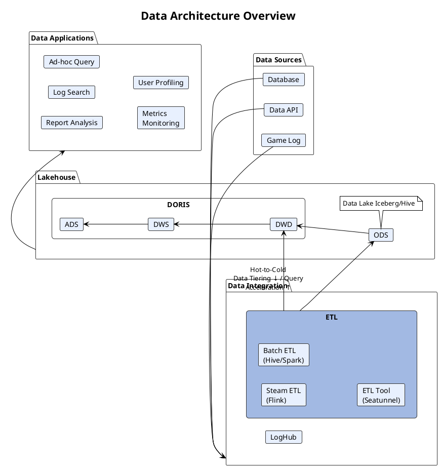

题目：煎饼派对（游戏）出海——阿里云 ClickHouse 企业版托管方案

# User Cases
“煎饼派对”是一家快速成长的中国数字原生企业，正在加速拓展海外市场。
目前，客户的数据分析平台主要基于自建的 Apache Doris 和 StarRocks，包括以下核心场景：


## 游戏数据分析的核心场景
游戏数据分析的核心场景
### 一、玩家行为分析
* 通过分析玩家在游戏中的行为路径，优化游戏设计与用户体验。典型应用包括：
* 识别玩家流失节点：定位玩家离开的关键环节，针对性改进关卡设计
* 分析玩家留存率：制定精准的召回策略，提升玩家回流

追踪道具使用情况：优化道具定价与投放策略，提升变现效率

### 二、运营指标监控
* 实时监控关键运营指标，帮助运营团队快速响应业务变化：
* 用户规模指标：日活跃用户数（DAU）、月活跃用户数（MAU）
* 商业化指标：付费转化率、平均每用户收入（ARPU）
* 系统健康指标：服务器延迟、崩溃率等性能指标

### 三、商业智能分析
* 通过多维度数据分析，为商业决策提供支撑：
* 用户付费能力对比：按地区、设备类型等维度分析付费差异
* 营销活动效果评估：衡量活动投入产出，优化营销策略
* 用户生命周期价值（LTV）预测：预判用户长期价值，指导资源分配


## Data Profile
每天产生的20TB玩家行为数据，高吞吐（日均亿级事件）、高维度（200+分析指标）、高时效（实时监控需求）。以某MMORPG游戏为例，单个玩家在一次副本战斗中就可能产生50+条事件日志，包括移动轨迹、技能释放、伤害统计等。传统方案如Hive +Spark批处理模式难以满足实时分析需求，而Kylin等预计算方案又缺乏灵活性。
高基数维度（玩家ID可能上亿）
Ingestion speed: 50 ~ 200MB/s, 高并发写入（峰值可达50万QPS）

随着海外业务规模增长 ，客户出海面临诸多挑战：

# Pain points & Objectives
# Pain Points & Objectives

## 一、运维成本高

### 1.1 存储可靠性风险：单盘故障引发分片级崩溃
- 单个磁盘故障可能导致整个分片（shard）崩溃，是最令人担忧的风险
- 一旦发生，部分项目将面临长时间的数据完全不可用
- 数据盘级联故障是长期高磁盘占用项目中并不罕见的问题

### 1.2 MinIO 运维风险：在线升级与扩容困难
- MinIO 在线升级风险高
- 随着数据量增长，服务故障频率上升；向 MinIO 集群增加资源收效甚微
- 故障逐渐频繁，导致 ETL 流程崩溃，Airflow 工程师需耗费大量时间排查与恢复失败的 ETL

### 1.3 On-Prem Doris本身运维负担重
- 升级、备份与故障排查均不轻松

### 1.4 Apache Doris扩容步骤复杂，BE扩容后需要数据再平衡
- FE，BE需要分别扩容
- BE扩容后需要数据再平衡，数据再平衡过程可能导致资源占用引起性能下降，而且再平衡过程可能需要数小时甚至数天，严重影响业务稳定性。

## 二、数据洪峰应对（Traffic Spikes）

当新游戏版本上线时，日志量会出现 **10–20 倍**的瞬时爆发。系统必须具备良好的水平扩展性；同时当游戏进入平稳期，能否进行缩容避免资源浪费。


## 三、实时决策要求（Real-Time Decision Making）

运营需要即时感知各类指标：

- **异常道具交易波动**（可能预示外挂行为）
- **新手关卡流失点**（需要快速调优）
- **活动参与热度**（用于动态调整奖励）

**性能指标**：亿级事件聚合约 1 秒内完成

---

## Objectives

1. **存储可靠性**（Storage Reliability）
2. **运维可靠性**（Operational Reliability）
3. **易于维护**（Ease of Maintenance）
4. **可扩展性**（Flexibility for Growth）
5. **预算内的最优成本**（Optimal Cost for Our Budget）

# Intro of Clickhouse Enterprise

核心信息：ClickHouse 是为 AI 时代实时分析负载而设计的列式 OLAP 数据库。

四个关键特性（页面主体，建议四宫格或四行布局）

1. 毫秒级处理：即使数据规模达到 PB 级，查询仍可在毫秒级返回
2. 高 QPS 并发：支持高并发查询同时执行
3. 极高压缩率：存储容量可缩减数十倍
4. 弹性伸缩：根据负载动态扩缩容

# Solutions

## Architecture Overview


## 典型分析场景实现
3.1 玩家留存魔法矩阵 
游戏运营最看重的7日留存分析，传统方案要跑半小时，我们用ClickHouse实现秒级响应：
```sql
SELECT
    first_day,
    countDistinctIf(player_id, day = 0) as d0,
    countDistinctIf(player_id, day = 1) / d0 as retention_1,
    ...
FROM (
    SELECT
        toDate(min(event_time)) as first_day,
        player_id,
        dateDiff('day', first_day, event_date) as day
    FROM gameplay_events
    WHERE event_type = 'login'
    GROUP BY player_id, day
)
GROUP BY first_day
```


1. 日活跃用户数（DAU）统计
```
SELECT 
    toDate(event_time) AS date,
    COUNT(DISTINCT player_id) AS dau
FROM player_behavior
WHERE event_time >= toDateTime('2023-01-01')
GROUP BY date
ORDER BY date;
```

2. 玩家留存率分析
```sql
WITH first_login AS (
    SELECT 
        player_id,
        MIN(toDate(event_time)) AS first_date
    FROM player_behavior
    GROUP BY player_id
)
SELECT 
    first_date AS register_date,
    toDate(event_time) AS login_date,
    COUNT(DISTINCT player_id) AS active_users,
    ROUND(COUNT(DISTINCT player_id) / 
          (SELECT COUNT(DISTINCT player_id) FROM first_login WHERE first_date = register_date), 2) AS retention_rate
FROM player_behavior
JOIN first_login USING (player_id)
WHERE login_date BETWEEN first_date AND first_date + INTERVAL 7 DAY
GROUP BY register_date, login_date
ORDER BY register_date, login_date;
```

3. 道具购买分析
```sql
SELECT 
    道具_id,
    COUNT(DISTINCT player_id) AS buyers,
    SUM(payment_amount) AS total_revenue,
    AVG(payment_amount) AS avg_price
FROM player_behavior
WHERE event_type = 'purchase'
    AND event_time >= toDateTime('2023-01-01')
GROUP BY 道具_id
ORDER BY total_revenue DESC
LIMIT 10;
```

3.1 玩家行为路径分析
使用 windowFunnel 函数追踪转化路径：
```sql
SELECT 
    server_id,
    windowFunnel(3600)(event_time, 
        event_type = 'enter_dungeon',
        event_type = 'boss_encounter',
        event_type = 'boss_defeat'
    ) AS funnel_steps
FROM game_logs
WHERE event_time >= now() - INTERVAL 7 DAY
GROUP BY server_id
```

3.2 实时经济监控
构建虚拟经济仪表盘：
```sql
-- 物价波动监控
SELECT 
    item_id,
    avg(price) AS avg_price,
    median(price) AS median_price,
    argMax(price, event_time) AS latest_price
FROM (
    SELECT 
        JSONExtractUInt(extra, 'item_id') AS item_id,
        JSONExtractFloat(extra, 'price') AS price,
        event_time
    FROM game_logs
    WHERE event_type = 'auction_sold'
      AND event_time >= now() - INTERVAL 1 HOUR
)
GROUP BY item_id
HAVING avg_price > 1000
ORDER BY (latest_price - avg_price)/avg_price DESC
LIMIT 10
```

3.3 作弊行为检测
基于统计异常检测：

```sql
-- 检测异常道具获取
SELECT 
    uid,
    count() AS items_gained,
    sum(JSONExtractFloat(extra, 'item_value')) AS total_value,
    total_value/items_gained AS avg_value
FROM game_logs
WHERE event_type = 'item_acquired'
  AND event_time >= now() - INTERVAL 24 HOUR
GROUP BY uid
HAVING items_gained > 100 
   AND avg_value > (
       SELECT avg(JSONExtractFloat(extra, 'item_value'))
       FROM game_logs 
       WHERE event_type = 'item_acquired'
   ) * 10
```

## Migration Strategy

For the existing system in China:
Run two systems in parallel for a period of time, ensuring that the results matched exactly before switching over completely.
- Kafka events (like CDC events): consumed by both systems
- Flink Jobs: ingest results to both systems

For the new system overseas:
Setup the new system in Aliyun, all data sources route data to Clickhouse Enterprise.


Step 1: DDL 解析与模型适配（结构解析与性能推导） 
Step 2: 任务复制与双路写入（离线与实时双跑机制） 将原本的 Hive/Kafka to Apache Doris 任务无缝复制为 Hive/Kafka to Clickhouse。离线链路可以通过阿里云的DTS进行批量导入。
Step 3: 存量数据弹性补数（读写分离与高吞吐回刷） 针对缺失 Hive 历史的场景，搭建 ClickHouse Dump 专有集群，采用 HardLink 隔离线上读写，导出吞吐达 1 GB/s；对于 Hive 数据完整的场景，直接通过 Spark 调度进行历史数据重刷。
Step 4: 四阶段自动化数据校验（全方位指标校验与回放） 依次执行“行数统计 -> 核心指标聚合 -> 浮点精度阈值校验 -> 真实业务 SQL 回放比对”，任何偏差自动触发断路器阻断迁移。
Step 5: 正式下线 Doris 集群与写入任务。


## Avoid JOIN
non-join VS join: non-join performance is 10x ~ 100x faster than join. 
the best practice for performance is to avoid unnecessary join or low efficient join. 

Two Approaches:
1. pre-built wide table to avoid join
2. convert right tables to dictionary or use direct join

# Value Proposition

## Low overall TCO
### to Cloud but not SasS still cost a lot
However, the cost issue still needs to be solved. Here’s a detailed explanation: Moving to AWS without ClickHouse Cloud provides more powerful hardware but at a much higher price due to the large amount of data. AWS can help mitigate inefficient configurations by allowing the use of a single "fat" server. We could use one large shard instead of multiple smaller ones and put a ton of drives in there, but we’d still need at least two replicas. This would mean managing 240 TB of data on disks, costing thousands of extra dollars for storage alone, not including other expenses. So, cost remains a significant concern.
There are also options to split data into hot and cold storage, potentially halving the costs. However, these solutions need extensive planning, testing, and time from a highly qualified engineer. The challenge is finding the correct configuration for our data processing patterns without compromising speed and service quality in the future.

### Increased reliability and stability with less maintenance effort
1. Storage reliability: ALL critical units (DB, S3) are included in a “service” that guarantees reliability. We offloaded many complex tasks, making SaaS solutions incomparably cheaper.
2. Operational reliability, growth flexibility, and optimal cost: Achieved 100%.
3. Ease of maintenance: Solved by 80-85%. The problem wasn’t completely eliminated but was significantly reduced. Considering the resources invested, this is a good result, more than compensating for the slight cost increase as we’ve saved a lot of engineers’ time.
5. We spent three months of full-time work from two engineers and a month of my time on the move. The cost of service not only remains comparable but is covered many times over by the benefits received.

### Reduced Complexity:
1. MinIO, which was replaced by Amazon S3.
2. Three different Airflow deployments. The latest version on excellent hardware handles the entire load perfectly.
3. Numerous unnecessary configs and scripts for the setup and maintenance of old servers.

## Fast and Smooth Scaling for peak users increasing
4. Flexibility for growth: Achieved 100%. no downtime, no data rebelancing, scale stateless compute nodes alone. gained the ability to scale 2x, 5x, or 10x in minutes when needed
5. By achieving results faster at the exact resource cost, the business naturally benefits.

## Open to a wide Clickhouse ecosystem
For trace analysis on opentelemetry: ClickStack, SigNoz

# Testmonial from Gaming Customers
* Azure Games:
* Suprema Gaming: Suprema Gaming uses ClickHouse as the trace store for its observability platform, monitoring the backend behind its mobile games for millions of players.
* Roblox:
* Uken GAmes: Uken Games uses ClickHouse as the trace store for its observability platform, monitoring the backend behind its mobile games for millions of players. 
1 node, 170GB traces, 87% cheaper
along with SigNoz, Prometheus and Granfana
* Suprema Gaming: 500K users, 70 countries, 62 cheaper

# Strategy Against Doris or StarRocks

1. Doris is better than OpenSource Clickhouse not Clickhouse Enterprise. 

Doris is a good choice for small and medium-sized businesses that need a simple and cost-effective solution for their data warehousing needs. However, Clickhouse Enterprise is a better choice for large enterprises that need a more powerful and scalable solution. Clickhouse Enterprise offers features such as high availability, security, and support that are not available in Doris.
# Why Choose Apache Doris

| Category                     | Apache Doris                                                                                                                                                                                                                                                                    | ClickHouse OpenSource                                                                                                                                                                                                                                 | Clickhouse Enterprise |
|------------------------------|---------------------------------------------------------------------------------------------------------------------------------------------------------------------------------------------------------------------------------------------------------------------------------|-------------------------------------------------------------------------------------------------------------------------------------------------------------------------------------------------------------------------------------------------------|-----------------------|
| **Architecture & SQL**       | • Based on MPP architecture<br>• Standard SQL, MySQL-compatible                                                                                                                                                                                                                 | • Uses Scatter-Gather architecture<br>• SQL-like capabilities but with non-standard SQL                                                                                                                                                               ||
| **Queries**                  | • Distributed joins<br>• Cost-Based Optimization (CBO)<br>• Query rewrites and multi-table materialized views<br>• Higher concurrent performance<br>• Native ASOF JOIN, faster in all 11 scenarios                                                                              | • Poor join implementation<br>• Lacks a Cost-Based Optimizer (CBO)<br>• Only supports single-table materialized views<br>• Lower concurrency performance<br>• ASOF JOIN 1.6x to 7x slower in the same tests                                           ||
| **Real-time Updates**        | • Performance: Real-time updates 18-34x faster on SSB, 2.5-4.6x on ClickBench<br>• Built-in CDC for MySQL and PostgreSQL, no external pipeline<br>• Strong consistency: upserts and deletes visible to the next query<br>• Merge-on-write: primary key index with delete bitmap | • Query performance degrades as updates increase<br>• CDC changes land only as new row versions until a merge runs<br>• Old values readable until a background merge completes<br>• ReplacingMergeTree deduplicates at read time with FINAL or argMax ||
| **Data API**                 | • Offers high-throughput read APIs based on Arrow-flight, facilitating integration with other engines such as data science/AI tools                                                                                                                                             | • Only inefficient data reading via JDBC API                                                                                                                                                                                                          ||
| **Building Open Lakehouse**  | • Serves as a Lakehouse SQL engine, supporting queries on Hive, Hudi, Iceberg, and Parquet data lake formats                                                                                                                                                                    | • Limited Lakehouse integration capabilities                                                                                                                                                                                                          ||
| **Operations & Maintenance** | • Supports automatic scaling in, scaling out, and replica balancing                                                                                                                                                                                                             | • Requires manual rebalancing during scaling operations                                                                                                                                                                                               ||
| **Performance**              | • In wide table benchmarks (ClickBench), Doris ranked top 1 or top 2 in October 2022 and October 2024, outperforming ClickHouse<br>• In large TPC-H and TPC-DS tests, Doris achieved leading performance                                                                        | • In terms of ClickBench performance, ClickHouse and Doris have been taking turns leading<br>• Experiences many OOM (Out of Memory) queries in large TPC-H and TPC-DS tests                                                                           ||
| **Deployment**               | • VeloDB, a commercial company with products based on Apache Doris, provides cloud-native services on AWS, Azure, and GCP, as well as mature SaaS and Bring Your Own Cloud (BYOC) versions<br>• VeloDB also offers an on-premises enterprise version                            | • Currently, ClickHouse's BYOC version is still in invite-only beta testing<br>• No on-premises enterprise version is available for ClickHouse                                                                                                        ||

2. Non-join is always faster than join
Avoid unnecessary joins or low-efficient joins to gain more performance in production.

3. Doris need to balance BE data when scale out while Clickhouse Enterprise can scale out without rebalancing data at all.

4. Choose Clickhouse Enterprise is not choose a OLAP engine but a wide ecosystem.


# User Cases
In 2025, the freshest data anyone could look at was already four hours old. For a business where thousands of players are active, that lag prevented the team from running investigations, diagnosing incidents, or understanding user behavior at the moment it happens.
[Suprema Gaming](https://clickhouse.com/blog/suprema-gaming-agent-ready-platform)


## Move to AI
to become an agentic-first business, where people use AI agents, not static dashboards, to ask questions and act on the answers.

AI Security
Governance at Suprema goes beyond regulatory compliance; it is a core enabler of the company’s AI strategy. Agents are treated as governed consumers and held to the same standards as every other user of the platform, including access control, data minimization, PII masking, traceability, and auditing. As new agents enter the ecosystem, the controls evolve alongside them, allowing Suprema to innovate without compromising trust in its data.

The system is also fully observable. Every conversation generates controlled traces in Langfuse, including latency, cost, and the SQL behind each answer. This makes the agentic layer just as auditable as the data pipeline.

Such fast-paced, simple games generate massive amounts of telemetry data from user interactions, which is crucial for understanding player behavior, optimizing monetization, experimenting, and improving the overall gaming experience. [Azure Games](https://clickhouse.com/blog/azure-games-clickhouse) 

The safety team automates over 90% of decisions. ClickHouse logs these ML decisions, tracks model verdicts, records who made them, and lets teams compare multiple models in real time.

## MISC tips
利用 ALTER TABLE FREEZE 实现赛季数据秒级快照：
```
# 赛季结束时执行
ALTER TABLE season_data FREEZE WITH NAME 'season_2023_final'

# 新赛季创建时恢复
ALTER TABLE season_data ATTACH PARTITION '202401' FROM 'season_2023_final'
```

预聚合 ：对固定维度的指标预先计算
```sql
CREATE TABLE daily_user_stats (
    stat_date Date,
    user_id UInt64,
    login_count UInt16,
    play_minutes UInt32,
    payment_total Decimal(18,2)
) ENGINE = SummingMergeTree()
ORDER BY (stat_date, user_id);
```

跳数索引 ：加速特定条件查询

```
ALTER TABLE game_events ADD INDEX idx_item(item_id) TYPE bloom_filter GRANULARITY 3;
```

冷热数据分离 ：将历史数据转移到廉价存储
```sql
CREATE TABLE game_events_archive AS game_events 
ENGINE = Distributed('archive_cluster', currentDatabase(), 'game_events');
```